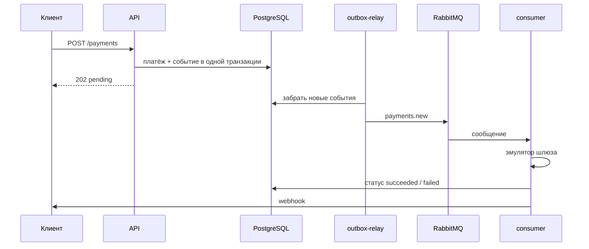

# Payment Processing Service

Сервис принимает платёж по API, обрабатывает его в фоне через эмулятор платёжного шлюза
и сообщает клиенту результат на его webhook.

Стек: FastAPI, Pydantic v2, SQLAlchemy 2.0 (async), PostgreSQL, RabbitMQ (FastStream), Alembic, Docker.

## Запуск

```bash
docker compose up -d --build     # или make up
```

Файл `.env` не нужен: для локального запуска всё настроено по умолчанию (пример настроек в
`.env.example`). Миграции накатываются сами перед стартом приложения. Нужен Docker Compose 2.24+.

После запуска доступно:

- API и Swagger: http://localhost:8000/docs (API-ключ `local-dev-api-key`)
- RabbitMQ: http://localhost:15672 (guest / guest)
- тестовый приёмник webhook: http://localhost:8080/webhooks/{payment_id}

Прогнать основные сценарии на поднятом стеке:

```bash
make e2e
```

Скрипт проверяет авторизацию, повторные запросы, успешный платёж, повтор webhook после ошибок,
попадание в DLQ и обработку 20 платежей одновременно.

## Как это работает

1. Клиент отправляет `POST /api/v1/payments`. API сохраняет платёж со статусом `pending` и сразу
   отвечает `202`.
2. Вместе с платежом, в той же транзакции, в таблицу `outbox` записывается событие
   «платёж создан».
3. Сервис `outbox-relay` раз в секунду забирает новые события из `outbox` и отправляет их
   в очередь `payments.new`.
4. Сервис `consumer` берёт сообщение, «проводит» платёж через эмулятор шлюза (2-5 секунд,
   90% успешных), записывает итоговый статус и отправляет клиенту webhook.
5. Если webhook не дошёл, сообщение уходит на повтор. После трёх неудачных попыток оно
   попадает в очередь `payments.new.dlq`.



Сервисы в `docker-compose.yml`:

| Сервис | Что делает |
|---|---|
| `api` | Создание и просмотр платежей |
| `outbox-relay` | Переносит события из БД в RabbitMQ |
| `consumer` | Обрабатывает платежи и шлёт webhook |
| `migrate` | Накатывает миграции и завершается |
| `webhook-sink` | Тестовый клиент для приёма webhook, умеет имитировать ошибки |
| `postgres`, `rabbitmq` | База и брокер |

## API

Все запросы к `/api/v1/payments` требуют заголовок `X-API-Key`. Без ключа открыты только
`/health` (для healthcheck Docker) и документация `/docs`: данных о платежах там нет,
а в Swagger ключ вводится через кнопку Authorize.

### Создать платёж

```bash
curl -i -X POST http://localhost:8000/api/v1/payments \
  -H 'X-API-Key: local-dev-api-key' \
  -H 'Idempotency-Key: order-42' \
  -H 'Content-Type: application/json' \
  -d '{
        "amount": "1500.50",
        "currency": "RUB",
        "description": "Заказ #42",
        "metadata": {"order_id": 42},
        "webhook_url": "http://webhook-sink:8080/webhooks"
      }'
```

```http
HTTP/1.1 202 Accepted

{"payment_id": "f02c116a-f172-4447-bcb4-b6c1473dae3b", "status": "pending", "created_at": "2026-10-16T20:17:04.775726Z"}
```

Возможные ответы:

- `202` - платёж принят. Если повторить запрос с тем же `Idempotency-Key` и тем же телом,
  вернётся тот же платёж и заголовок `Idempotent-Replayed: true`, второй платёж не создастся.
- `409` - этот `Idempotency-Key` уже использован с другими данными.
- `422` - нет `Idempotency-Key` или тело невалидно (сумма не больше нуля, больше двух знаков
  после запятой, неизвестная валюта, неправильный URL).
- `401` - нет `X-API-Key` или он неверный.

В примере webhook уходит в тестовый приёмник внутри docker-сети. Чтобы посмотреть на повторы
и DLQ, добавьте к адресу `?fail_first=2` (первые две попытки получат ошибку 500) или
`?fail=always`.

### Получить платёж

```bash
curl http://localhost:8000/api/v1/payments/f02c116a-f172-4447-bcb4-b6c1473dae3b \
  -H 'X-API-Key: local-dev-api-key'
```

```json
{
  "payment_id": "f02c116a-f172-4447-bcb4-b6c1473dae3b",
  "amount": "1500.50",
  "currency": "RUB",
  "description": "Заказ #42",
  "metadata": {"order_id": 42},
  "status": "succeeded",
  "idempotency_key": "order-42",
  "webhook_url": "http://webhook-sink:8080/webhooks",
  "created_at": "2026-10-16T20:17:04.775726Z",
  "processed_at": "2026-10-16T20:17:07.509553Z",
  "webhook_delivered_at": "2026-10-16T20:17:07.545201Z"
}
```

Сумма передаётся строкой, чтобы не терять точность на float.

### Webhook

```http
POST {webhook_url}
Content-Type: application/json
X-Webhook-Timestamp: 1792181827
X-Webhook-Signature: sha256=<HMAC-SHA256 от "<timestamp>.<тело>" с ключом WEBHOOK_SECRET>

{"event": "payment.succeeded", "payment_id": "...", "status": "succeeded",
 "amount": "1500.50", "currency": "RUB", "metadata": {"order_id": 42}, "processed_at": "..."}
```

По подписи клиент может проверить, что запрос пришёл от нашего сервиса. Timestamp входит
в подпись, поэтому старый перехваченный запрос можно отбросить по времени. Один и тот же webhook
в редких случаях может прийти дважды, поэтому на стороне клиента его стоит проверять
по `payment_id`.

## Важные решения

### Outbox: событие не теряется

Если сохранить платёж в базу, а потом отдельно отправить сообщение в RabbitMQ, между этими
шагами можно упасть: платёж есть, а события нет. Поэтому событие пишется в таблицу `outbox`
в той же транзакции, что и платёж, а отдельный сервис потом переносит его в очередь.

- Если RabbitMQ лежит, API продолжает принимать платежи. События дойдут, когда брокер вернётся,
  а relay пока пробует с растущей паузой, до 30 секунд.
- Событие считается отправленным, только когда RabbitMQ подтвердил, что принял его.
- Relay берёт строки через `FOR UPDATE SKIP LOCKED`, поэтому можно запустить несколько копий,
  и они не отправят одно событие дважды.

### Защита от дублей

- **Повторный запрос в API.** На `idempotency_key` стоит уникальный индекс, вставка идёт через
  `INSERT ... ON CONFLICT DO NOTHING`. Даже если два одинаковых запроса придут одновременно,
  платёж будет один. Чтобы отличить честный повтор от ошибки клиента, хранится хеш тела запроса.
- **Повторное сообщение в очереди.** В сообщении только `payment_id`, всё остальное consumer
  читает из базы. Шлюз вызывается, только пока платёж в `pending`, а статус обновляется условием
  `WHERE status = 'pending'`. Повторное сообщение не спишет деньги второй раз.
- **Шлюз.** Эмулятор, как настоящий шлюз, на повторный вызов с тем же `payment_id` возвращает
  прошлый результат.
- **Webhook.** После успешной отправки ставится `webhook_delivered_at`, и повторно уведомление
  не отправляется.

### Повторы и DLQ

- Всего 3 попытки: первая и два повтора, с паузами 1 и 2 секунды. Настраивается через
  `MAX_ATTEMPTS` и `RETRY_BASE_DELAY_MS`.
- Пауза делается средствами RabbitMQ, а не `sleep` в коде: сообщение ждёт в отдельной очереди
  с TTL и потом возвращается в `payments.new`. Consumer при этом свободен, а ожидание переживёт
  его перезапуск. Плагины RabbitMQ не нужны.
- На каждую паузу своя очередь, потому что RabbitMQ проверяет TTL только у первого сообщения
  в очереди, и короткая пауза застряла бы за длинной.
- Повторяются ошибки отправки webhook и неожиданные ошибки, например недоступность базы.
  Отказ шлюза (те самые 10%) не считается ошибкой: это нормальный результат `failed`, и клиент
  получает о нём webhook.
- Сразу в DLQ, без повторов, уходят сообщения о несуществующем платеже и сообщения, которые
  не удалось прочитать.
- Основная очередь сделана quorum-очередью с ограничением на 5 доставок: если consumer падает
  прямо на сообщении, оно не будет ронять его бесконечно, а уйдёт в DLQ.

```
payments ──> [payments.new] ──> consumer
                  │ попытки кончились / сообщение битое
                  v
payments.dlx ──> [payments.new.dlq]

payments.retry ──> [payments.new.retry.1000ms] (ждёт 1 с) ─┐
               ──> [payments.new.retry.2000ms] (ждёт 2 с) ─┴──> обратно в payments.new
```

В DLQ у сообщения видно номер попытки (`x-attempt`) и последнюю ошибку (`x-last-error`).
Когда причина устранена, сообщения можно вернуть в работу:

```bash
docker compose exec consumer python -m app.messaging.redrive            # все
docker compose exec consumer python -m app.messaging.redrive --limit 10 # первые 10
```

Это безопасно: уже проведённый платёж второй раз не спишется, клиент получит только
недошедший webhook.

### Остальное

- Consumer обрабатывает до 20 платежей одновременно (`CONSUMER_PREFETCH`): почти всё время
  уходит на ожидание шлюза и webhook, так что параллельность даёт большой выигрыш.
  20 платежей обрабатываются примерно за 6 секунд вместо 70.
- При остановке consumer доделывает текущие платежи (до 15 секунд).
- Пока идёт запрос в шлюз, транзакция в базе не держится открытой.
- `API_KEY` и `WEBHOOK_SECRET` обязательны: без них сервис не запустится. Значения для
  разработки подставляет только `docker-compose.yml`.

## База данных

```
payments                                    outbox
─────────────────────────────────           ──────────────────────────────────
id                  uuid PK                 id              uuid PK
amount              numeric(18,2) > 0       aggregate_type  'payment'
currency            RUB | USD | EUR         aggregate_id    uuid -> payments.id
description         text                    event_type      'payment.created'
metadata            jsonb                   routing_key     'payments.new'
status              pending | succeeded     payload         jsonb
                    | failed                created_at      timestamptz
idempotency_key     varchar UNIQUE          published_at    timestamptz (NULL = не отправлено)
request_hash        хеш тела запроса        attempts        int
webhook_url         varchar                 last_error      text
created_at          timestamptz
processed_at        timestamptz
webhook_delivered_at timestamptz
```

- У одного платежа может быть несколько событий в `outbox`. Внешнего ключа между таблицами нет
  специально: `outbox` - общий журнал событий, а не часть платежа.
- Сумма, валюта и статус дополнительно проверяются ограничениями в самой базе.
- Для поиска неотправленных событий есть частичный индекс по `published_at IS NULL`, поэтому
  relay работает быстро, сколько бы событий ни накопилось.

## Структура проекта

```
app/
  api/          роуты, проверка API-ключа, приложение FastAPI
  services/     создание платежа
  db/           модели и подключение к базе
  messaging/    очереди RabbitMQ и формат события
  relay/        outbox-relay
  consumer/     обработка платежа, шлюз, webhook, повторы
migrations/     миграции Alembic
devtools/       тестовый приёмник webhook
scripts/e2e.py  проверка сценариев на поднятом стеке
tests/          тесты
```

## Тесты

```bash
make test   # тесты в отдельном окружении с настоящими PostgreSQL и RabbitMQ
make lint   # ruff и mypy --strict
```

База и брокер в тестах настоящие, без моков: проверяется именно их поведение
(`ON CONFLICT`, `SKIP LOCKED`, TTL, DLQ). Тесты покрывают API, обработку платежей, повторы,
DLQ, возврат из DLQ и соответствие миграций моделям.

## Настройки

| Переменная | По умолчанию | Что задаёт |
|---|---|---|
| `API_KEY` | `local-dev-api-key` | Ключ для `X-API-Key` |
| `WEBHOOK_SECRET` | `local-dev-webhook-secret` | Ключ подписи webhook |
| `DATABASE_URL`, `RABBITMQ_URL` | сервисы из compose | Подключения |
| `GATEWAY_SUCCESS_RATE` | `0.9` | Доля успешных платежей |
| `GATEWAY_MIN_DELAY_S`, `GATEWAY_MAX_DELAY_S` | `2`, `5` | Время обработки в шлюзе |
| `MAX_ATTEMPTS` | `3` | Попыток до DLQ |
| `RETRY_BASE_DELAY_MS` | `1000` | Первая пауза перед повтором, дальше удваивается |
| `WEBHOOK_TIMEOUT_S` | `5` | Таймаут запроса webhook |
| `BROKER_PUBLISH_TIMEOUT_S` | `10` | Таймаут отправки в RabbitMQ |
| `CONSUMER_PREFETCH` | `20` | Сколько платежей обрабатывать одновременно |
| `OUTBOX_POLL_INTERVAL_S`, `OUTBOX_BATCH_SIZE` | `1`, `100` | Как часто и сколько событий забирает relay |
| `API_PORT`, `RABBITMQ_MANAGEMENT_PORT`, `WEBHOOK_SINK_PORT` | `8000`, `15672`, `8080` | Порты |

## Что можно улучшить

- Отправлять события сразу через `LISTEN/NOTIFY`, а не опрашивать `outbox` раз в секунду.
- Чистить старые отправленные события из `outbox`.
- Проверять `webhook_url`, чтобы через него нельзя было стучаться во внутреннюю сеть.
- Когда появятся настоящие клиенты, делать `Idempotency-Key` уникальным в рамках клиента
  и хранить ключи ограниченное время.
- Для webhook повторять дольше (минуты и часы, а не секунды), а при недоступности базы ждать
  её восстановления, не тратя попытки.
- Добавить метрики и алерты: размер очереди `outbox`, количество сообщений в DLQ,
  время ответа шлюза.
- Добавить rate limiting на API.
